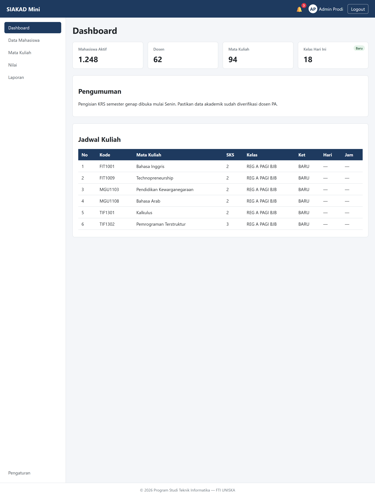
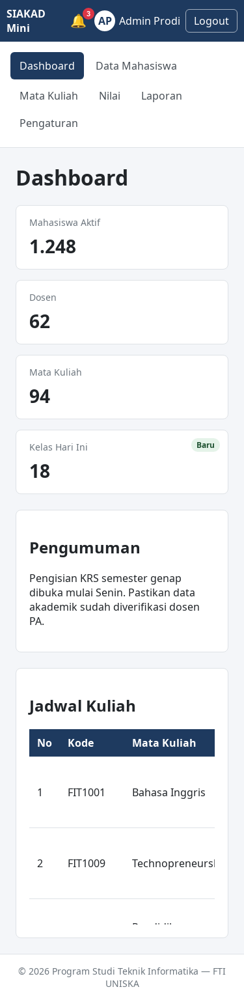

# Laporan Praktikum Pertemuan 5 — Pemrograman Web 1

Nama : Ariza Naufal Kholish 
NIM : 2510010223 
Kelas : 3A Reg BJB

## Percobaan 1 — Box Model

| No | Kondisi | Lebar Kotak A (px) | Lebar Kotak B (px) |
|---|---|---:|---:|
| 1 | Padding 20 px | 350 | 300 |
| 2 | Padding 40 px | 390 | 300 |

Pada Kotak A, lebar 350 px berasal dari 300 px isi, 20 px padding di setiap sisi, dan 5 px border di setiap sisi. Pada Kotak B, padding dan border sudah termasuk dalam lebar 300 px.

| No | Kondisi | Jarak judul–paragraf (px) |
|---|---|---:|
| 3 | Block biasa | 30 |
| 4 | Di dalam flex column | 50 |

Pada block biasa, margin bawah judul (30 px) dan margin atas paragraf (20 px) menyatu sehingga jaraknya 30 px. Dalam flex column, kedua margin dijumlahkan menjadi 50 px.

| No | Kondisi `.menu a` | Latar menimpa teks lain? (ya/tidak) |
|---|---|---|
| 5 | `inline` (bawaan) | Dari Yang saya coba, hasilnya tidak ada menimpa teks apapun, tidak sesuai dengan komentar yang ada yang mengatakan bahwa itu menimpa |
| 6 | `inline-block` | Tidak |

Pada tampilan yang diamati, latar biru tautan inline melampaui batas menu, tetapi huruf di atas dan bawahnya tetap terlihat utuh. Setelah tautan diubah menjadi inline-block, tinggi menu bertambah dari 21 px menjadi 45 px dan teks di bawahnya bergeser turun.

## Percobaan 2 — Flexbox Lab

Tabel 4.3 — Hasil berdasarkan kode praktikum

| No | Properti dan nilai | Pengamatan |
|---|---|---|
| 1 | `display: flex` | Awalnya kotak A, B, dan C masing-masing ada di baris sendiri. Begitu bagian `.lab` diberi `display: flex`, B dan C naik sejajar dengan A. Ketiga kotak juga sama tinggi karena ikut memenuhi tinggi lab yang 240 px. |
| 2 | `justify-content: space-between` | A menempel di kiri dan C di kanan. Ruang yang tersisa cuma dibagi ke dua tempat, yaitu antara A dan B serta antara B dan C. Itu sebabnya kedua jarak tersebut sama lebar. |
| 2 | `justify-content: space-evenly` | Bedanya paling gampang dilihat dari posisi A. Kalau tadi A menempel di kiri, sekarang ada ruang kosong sebelum A. Lebarnya sama dengan jarak A ke B, B ke C, dan ruang setelah C. |
| 3 | `align-items: stretch` dan `center` | Pas pakai `stretch`, kotak A yang isinya cuma satu huruf pun memanjang dari atas sampai bawah. Begitu diganti ke `center`, kotaknya jadi setinggi tulisan dan padding saja. Sekarang kelihatan ada ruang kosong di atas dan di bawah kotak. |
| 4 | `flex-direction: column` dan `justify-content: center` | Setelah pakai `column`, B ada di bawah A dan C ada di bawah B. Di sini arah susunannya sudah dari atas ke bawah, jadi waktu ditambah `justify-content: center`, ketiganya berkumpul di tengah tinggi lab. |
| 5 | 8 item × 200 px, `nowrap` dan `wrap` | Kalau delapan kotak tetap dipasang dalam satu baris, lebar 1000 px jelas kurang untuk delapan kotak yang masing-masing 200 px. Pada `nowrap`, kotaknya mengecil supaya semuanya muat. Begitu pakai `wrap`, kotak keenam mulai masuk ke baris kedua, jadi susunannya lima di atas dan tiga di bawah. |
| 6 | `.b { flex-grow: 1 }` | Yang paling kelihatan itu warna oranye pada B memanjang sampai mendekati C. Tulisan di dalamnya tetap sama. Karena cuma B yang diberi `flex-grow: 1`, ruang kosong di baris itu dipakai untuk menambah lebar B. |
| 7 | Lebar A / B / C (px) | A sudah ditetapkan 200 px, jadi dari lebar lab 1000 px masih ada 800 px untuk B dan C. B dapat satu bagian dan C dapat dua, berarti 800 px tadi dibagi tiga. Dari hitungan itu, lebar B sekitar 266,7 px dan C sekitar 533,3 px saat padding kiri dan kanan diatur ke 0. |
| 8 | `.c { order: -1 }` | Di halaman, C sekarang muncul duluan, baru A lalu B. Kalau dilihat lagi di HTML, C masih ditulis paling bawah. Ini karena nilai `order` C sekarang −1, lebih kecil dari nilai bawaan A dan B, yaitu 0. |
| 9 | `.c { margin-left: auto }` | A dan B masih berdampingan di kiri, tapi C bergeser sampai ke kanan. Ruang kosong yang tadinya ada di ujung baris sekarang ada di antara B dan C karena margin kiri C diatur ke `auto`. |
| 10 | `gap: 24px` | Setelah diberi `gap: 24px`, A dan B terpisah sejauh 24 px. Jarak yang sama juga kelihatan antara B dan C. Posisi awal A tetap karena gap hanya memberi jarak di sela-sela kotak. |

## Percobaan 3 — Positioning

| No | Eksperimen | Acuan dari modul | Hasil pengamatan |
|---|---|---|---|
| 1 | Header sticky saat digulir | Header menempel di atas saat halaman digulir dan memiliki ruang sendiri pada awal halaman. | |
| 2a | Header fixed tanpa padding atas pada body | Konten dimulai dari atas halaman sehingga bagian awalnya dapat tertutup header. | |
| 2b | Header fixed dengan padding atas 64 px | Konten dimulai di bawah header. | |
| 3 | Hapus `position: relative` dari `.notif` | Posisi badge mengacu pada header sehingga badge berpindah ke dekat sudut kanan atas header. | |
| 4 | Beri lapis 1 `z-index: 3`, lalu lapis 2 `z-index: 5` | Lapis 1 mula-mula berada di depan. Setelah perubahan kedua, lapis 2 menutupi lapis 1 di area irisan. | |
| 5 | Turunkan z-index header menjadi 1 | Saat halaman digulir, lapisan dengan z-index 3 atau 5 dapat menutupi header. | |
| 6 | Tombol Bantuan pada lebar layar 375 px | Tombol tetap berjarak 24 px dari tepi kanan dan bawah layar saat halaman digulir. | |

## Percobaan 4 — Dashboard

Simpan kedua tangkapan layar dashboard di folder `p4-dashboard` dengan nama berikut agar tampil di laporan.

## Jawaban Pertanyaan Analisis

1. **Mengapa menggunakan border-box di awal stylesheet?** Dengan aturan global border-box, lebar yang ditulis sudah mencakup padding dan border. Pada Kotak B, padding bisa dinaikkan dari 20 px menjadi 40 px tanpa mengubah lebar luar 300 px, sehingga ukuran kolom lebih mudah direncanakan.
2. **Mengapa item pada eksperimen column berkumpul di tengah secara vertikal?** Ketika arah flex diubah menjadi column, sumbu utama membentang dari atas ke bawah dan sumbu silang membentang mendatar. Karena justify-content mengatur posisi pada sumbu utama, nilai center membagi ruang kosong di atas dan bawah kelompok item secara merata.
3. **Bagaimana menghitung lebar B dan C, dan apa pengaruh basis auto?** Setelah A memakai 200 px dari wadah 1000 px, tersisa 800 px. Dengan basis nol dan faktor pertumbuhan 1 dan 2, B mendapat 800 × 1/3 ≈ 266,7 px dan C mendapat 800 × 2/3 ≈ 533,3 px. Jika B memakai `flex: 1 1 auto`, lebar awal B memperhitungkan isinya sebelum sisa ruang dibagi sehingga lebar akhir B dan C dapat berubah.
4. **Mengapa badge menempel ke header?** Badge memakai position absolute sehingga posisinya mengikuti leluhur terdekat yang membentuk acuan posisi. Setelah position relative pada tombol dihapus, header yang memakai position sticky menjadi acuan untuk nilai top dan right pada badge.
5. **Posisi mana yang dipilih untuk navbar dashboard?** Saya memilih sticky karena navbar tetap terlihat saat halaman digulir dan sejak awal memiliki tempat dalam susunan halaman. Pada navbar fixed, saya perlu menyediakan ruang setinggi navbar agar bagian awal konten dapat dibaca.
6. **Apa fungsi flex: 1 pada wrapper?** Pada body yang disusun sebagai flex column, wrapper memakai sisa ruang vertikal di antara navbar dan footer. Jika deklarasi itu dihapus, tinggi wrapper mengikuti isinya sehingga footer bisa naik saat konten halaman pendek.

## Kesimpulan

Dari Percobaan 1, saya memahami mengapa dua kotak dengan width yang sama bisa memiliki lebar luar berbeda. Saya juga melihat bahwa jarak judul dan paragraf berubah dari 30 px menjadi 50 px ketika wadahnya memakai flex column. Bagian yang sempat membingungkan adalah membedakan sorotan DevTools dari latar biru tautan. Setelah membandingkan kedua tampilan, saya melihat tinggi menu berubah meskipun teks di sekitarnya tetap terbaca.
